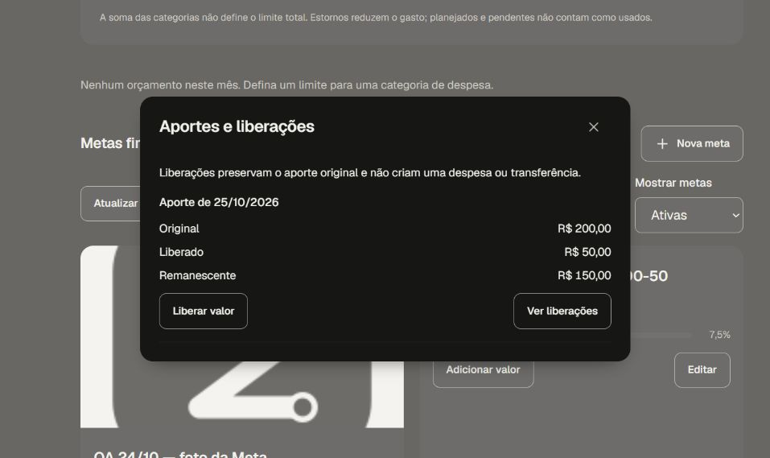

# Metas — positivo hospedado com uma conta QA

**Validado parcialmente em homologação:** criar conta com R$1.000, reservar R$200 e liberar R$50 preservou o saldo real deR$1.000 e deixou R$150 reservados. Uma despesa fictícia posterior deR$900 reduziu o saldo real aR$100, mantendo a reserva deR$150; o disponível derivado ficou−R$50. Não houve movimentação de dinheiro real.

A UI observada é o Preview `a8e5f5f718c96b3879ecc69cbf0450add3570c8e`, deployment `dpl_4dW1vVL5x9YKpCQ2hiGc1jWF9akQ`, somente no Supabase pessoal de homologação `twrydxsdemaykgvdlpyd`, com27 migrations. A referência de código é `6db9510538c4458cfaa9778466671312ef71f435`, mesma árvore src `760392b7d9ad33b2e3b5ea840800d52a302bd709`. Não houve novo deployment ou teste de UI6db.

## Confirmado por leituras independentes de Root

| Fase | Saldo real | Reserva ativa | Disponível derivado | Novos eventos / recibos | Novos lançamentos |
| --- | ---: | ---: | ---: | ---: | ---: |
| Conta + meta | R$1.000 | R$0 | R$1.000 | 2 / 2 | 0 |
| Reserva | R$1.000 | R$200 | R$800 | 3 / 3 | 0 |
| Liberação | R$1.000 | R$150 | R$850 | 4 / 4 | 0 |
| Despesa fictícia | R$100 | R$150 | −R$50 | 5 / 5 | 1 |

Foram cinco confirmações de domínio, uma por comando/tipo de evento, sem retry automático ou escrita SQL de domínio. A reserva original20000c e a liberação5000c foram preservadas. Em todos os checkpoints posteriores à baseline, os16 grupos anteriores e os dados financeiros antigos permaneceram iguais; disposições/fences novos0. A QA anterior de100c foi preservada: o patrimônio líquido total ficou10100c ao final, somando10000c do cenário novo e100c antigos.

## Observado na interface

Root conferiu a reservaR$200 e, após recarga integral, o histórico com originalR$200/liberadoR$50/remanescenteR$150 e progresso7,5%. A captura pública `goal-history-release-50.png` foi inspecionada nesta revisão e mostra esses três valores. Após a despesa, Root observou um único lançamento deR$900 e saldo da nova contaR$100, mantendoR$150 na meta. **O disponível−R$50 foi confirmado somente por SELECT; não foi exibido na UI.**

A revisão inicial da nova meta foi recusada com mensagem genérica; a causa exata não foi observada. A falha permanece registrada, com zero nova meta após a recusa. A continuação explícita “Continuar sem nova foto” preparou outra revisão nominal, sem repetir a revisão original; a confirmação financeira ocorreu separadamente.

A preservação de Storage tem fronteira específica: **após a recusa inicial e antes da continuação explícita**, havia1file/1reserva de upload/2objetos nos dois buckets privados. O digest permaneceu igual após a revisão explícita e os quatro/cinco efeitos. Não se afirma igualdade anterior à recusa nem leitura/igualdade dos bytes do journal local. Nenhum upload novo foi executado; isso não aceita os negativos completos de Storage.

## Pendente

A #79 permanece aberta: duas identidades/HTTP/RLS, replay exato de client_id, concorrência, IDs estrangeiros, datas futuras e demais negativos/lifecycle de imagem não foram aceitos por este ensaio. Disponível negativo não comprova recusa de um aporte novo insuficiente. Este ensaio não qualifica o CI da candidata6db, aparelho físico, aceite humano final, merge ou produção. Os dados QA foram preservados; não houve limpeza ou exclusão de linhas/contas.

Recibo público de Root observado até25/10/2026 04:20:18Z, SHA256 `0956495ddf29ade7ef2c9bb75f45ad58165c868bd37f0cc0ac697ba6cea88895`; captura SHA256 `bba90241793d6640176212c965e01827ab9bf15b37e33427303b437e468c9555`. A revisão independente leu somente esse recibo e a imagem pública: nenhuma nova query, teste, conexão ou arquivo privado.

[Evidência estruturada](evidence/finance-goals-ui-oneactor-current27-20261025.json). A QA agora tem duas contas, duas metas e um lançamento fictício; o consumo de R$900 sobre o limite antigo de R$0,50 é derivado dessa despesa. Não apagar dados nem pressupor zero lançamentos para repetir os testes antigos.

