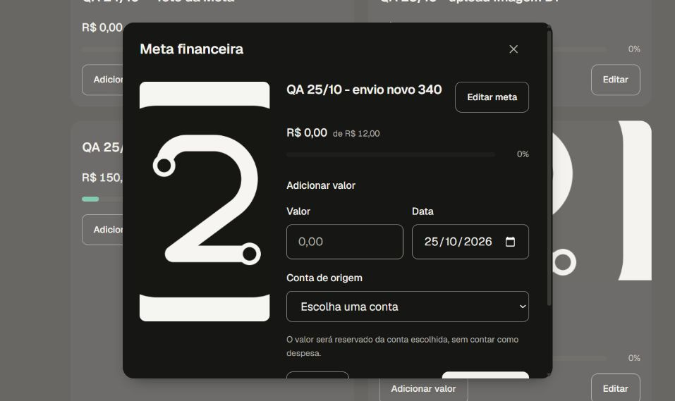

# Imagem de Metas — recorte hospedado desktop de 25/10/2026

Source `3403a5aa1901c166e6cfc1206848bfdc1c34957a`, Preview isolado `dpl_5SAkeYyRFkWYRSaStkfrQHJjL1N4`, READY e ligado a Twry pelo Root. Escopo: desktop, um usuário Auth QA existente, valores artificiais, duas contas financeiras e um lançamento fictício. As duas metas originais foram preservadas por observação da UI. Não é uma comparação de imutabilidade por SQL nem um ensaio entre duas identidades Auth.

O Root observou os seguintes caminhos, usando o protocolo já existente:

- **A, recuperação:** a tentativa do D1 foi consultada como `ready-unbound`, revisada e confirmada uma vez, sem novo upload nessa recuperação. A terceira meta, alvo R$ 10, persistiu após recarga com a foto carregada. A causa da falha inicial do D1 continua `UNKNOWN`.
- **Continuação pelo fluxo R:** após reload, Reconhecer foto salva retornou `PENDING`/`recover`, recusa esperada sem a prova em RAM. Concluir envio anterior para trocar chegou a `retirement-review`, preservando A, a meta e o arquivo. A escolha B foi feita explicitamente com a mesma fixture pública.
- **B, envio novo:** Usar nova foto e uma revisão chegaram à revisão financeira. A quarta meta, alvo R$ 12, foi confirmada uma vez. Após atualizar e reconhecer os dados na UI, no mesmo cliente antes do reload, Nova meta → Consultar → Reconhecer foto foi acionado uma vez e chegou a `retirement-review`. A edição foi fechada sem criar uma quinta meta.
- **Persistência observada:** depois de recarregar Planejamento, quatro metas estavam visíveis: as duas originais, A e B. Ao reabrir B, o Root verificou a imagem no diálogo aberto com `complete=true` e dimensões naturais de 512×512. Duas contas financeiras e um lançamento fictício continuaram visíveis.

A captura abaixo foi aberta localmente para revisão de privacidade e composição: mostra o diálogo, o ícone público e campos sintéticos, sem PII, URL ou token visíveis. Ela é um recorte da tela; as medidas DOM e a sequência de ações são observações do Root, não inferências dos pixels.

Nenhum protocolo novo foi necessário para a continuação observada. O fluxo R existente e o reconhecimento com a prova em RAM foram exercitados. A nota não declara encerrado o upload/recuperação integral: faltam negativos conectados de Auth/RLS/Storage, recortes móveis e demais critérios humanos. Restore #35 permanece pendente. Nesta continuação não houve delete, reset ou validação de dados por SQL/MCP; a nota não certifica cleanup físico nem ausência de órfãos.

A coorte Root desta Source encerrou 22 runs e 24 jobs SUCCESS por metadados. O original CURRENT27 push foi qualificado no escopo próprio: SQL23514 com CAS atual, material dos dois donos intacto, controle positivo Core, 136 Sources e 45 dependências vinculados, pending0 e cleanup confirmado. O original PR e os demais originais/artefatos não são aceitos por herança. [Metadados da coorte](evidence/ci-3403-root-20261025.json) · [CURRENT27 push qualificado](evidence/current27-push3403-qualified-20261025.json). Merge e produção permanecem bloqueados. [Comprovante estruturado](evidence/goals-image-hosted-3403-20261025.json) · [Diagnóstico local](goals-image-local-diagnostic-20261025.md).

## Conferência somente leitura após reautenticar o MCP

A URL da conexão foi conferida como Twry e o ledger continuou com 27 migrations, última versão 20261024160005. Duas consultas em transações repeatable read/read only, encerradas com ROLLBACK, retornaram somente contagens e metadados das imagens QA. Não houve escrita.

A única Meta âncora delimitou o dono: quatro Metas, duas contas financeiras e um lançamento. As duas novas Metas A/B possuem dois arquivos próprios distintos, cada um com um objeto Storage e uma reserva finalized; cada Meta tem um evento created e um recibo finance.goal.create. Isso liga os registros observados, sem comparar payloads inteiros ou provar os bytes dos objetos.

A consulta original esperava, incorretamente, que ambas as imagens fossem 512×512 e encontrou apenas uma. Esse desvio foi preservado. A conferência de dimensões mostrou A 192×192 e B 512×512, ambas finance_goal_image ativas e não purgadas, coerentes com as observações anteriores da UI. A consulta não foi alterada nem repetida para produzir PASS. Não é uma falha observada do produto.

[Contagens, expectativa original e limites](evidence/goals3403-read-only-links-20261025.json). Essa conferência não comprova imutabilidade dos demais grupos, ausência global de órfãos, limpeza física ou RLS entre duas identidades, nem acrescenta um gate às issues financeiras já encerradas tecnicamente.
