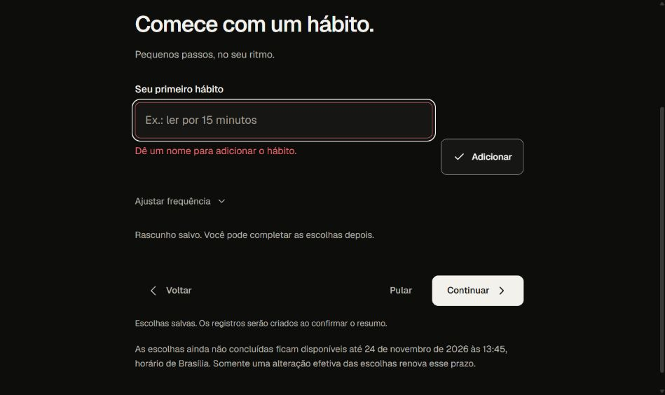

# Onboarding D1 — erro de nome vazio reconferido no Preview

**VALIDADO no recorte conectado:** deployment `dpl_AtGJNc2MU8dZwYHPNx9M9uS7R52J`, READY/targetnull, Source `d1d6c3138987a54670672df50a16ed4df942a135`, árvore `f0c373c2651cc0344c1d4e3d92b6a6e1b972d618`, src `8781d88211366a735b88102e19808da3d11ec690`. Branch de homologação `codex/homologacao-twry-20261022`, projeto Vercel pessoal `prj_68nPrMlzdTLhvhXF2zWvNK6BFaW2`, banco isolado `twrydxsdemaykgvdlpyd`.

A implantação foi selecionada somente para teste, enquanto o CI D1 continuava, conforme autorização de homologação isolada. Main e produção ficaram preservadas. De fe04 para D1 não há delta em Core, adapters, migrations, workflows ou Vercel. Os16 descritores de variáveis (IDs/branch/targets/timestamps) coincidiram integralmente com a seleção fe04; nenhum valor foi decriptado, passado ou alterado. O build do Preview concluiu, mas o [CI D1 falhou em um oráculo de scripts](ci-d1-20261025.md); não aceitar os gates SKIPPED por esse build.

## Percurso observado

Na sessão comum QA já existente, o onboarding retomou salvo na etapa Google. Avançar chegou ao hábito vazio. Ao clicar **Adicionar**, o campo recebeu foco, `aria-invalid=true` e `aria-describedby` ligado à mensagem de nome obrigatório. Nenhum foco corretivo foi imposto pelo teste.

Com o campo focado, Tab moveu ao botão Adicionar; Enter nesse botão retornou ao input, mantendo erro e vínculo acessível. AX e DOM concordaram. Isso reproduz o caso antes falho em fe04 e confirma a correção em D1, tanto por ponteiro quanto por teclado. A composição visual foi preservada.

Captura real do viewport, JPEG35.661bytes, SHA-256 `953269d4b7d123ea8730614944adf48c6b7bdc0d925475bbba117ac0a7f0c473`. Sem e-mail, agenda, conteúdo pessoal ou credencial visível; não é captura demo, montagem ou imagem gerada.

Depois do teste, Voltar restaurou a etapa Google com duas conexões e escolhas salvas. Não houve digitação de nova escolha, conclusão de resumo, OAuth, troca de calendário ou comando financeiro nessa reconferência. Não foi feita consulta SQL para afirmar imutabilidade de todas as tabelas; o recorte se limita às ações/estados observados. O rascunho e a sessão foram preservados.

## Reconferência conectada de projeto e tarefa

Uma segunda passagem no mesmo Preview D1 e na mesma sessão também validou **Nome do projeto** e **Sua próxima tarefa**. Em cada tela, clicar em Adicionar com o campo vazio focou o input, mostrou a mensagem específica e vinculou `aria-invalid=true` e `aria-describedby`. Tab saiu do input para o botão Adicionar; Enter nesse botão retornou o foco ao input. Não houve foco corretivo imposto pelo teste, texto digitado, escolha adicionada ou confirmação de resumo.

| Campo | Resultado por clique e teclado | Captura original |
| --- | --- | --- |
| Projeto | INPUT vazio, foco devolvido, erro vinculado | [JPEG, 35.128 bytes](evidence/onboarding-project-empty-focus-d1.jpg), SHA-256 `bbf9efc5eee133bdb962d24f7c0303874bf3de7e0988612f2c74580d0bbf7303` |
| Tarefa | INPUT vazio, foco devolvido, erro vinculado | [JPEG, 37.902 bytes](evidence/onboarding-task-empty-focus-d1.jpg), SHA-256 `758d491663285edabf4c966179e065633d3d0c28d7ba64fa7f41934097be245c` |

As capturas foram inspecionadas e copiadas byte a byte, sem edição ou geração de imagem. Não contêm e-mail ou conteúdo pessoal. Uma consulta DOM de diagnóstico usou inicialmente um construtor indisponível no ambiente de leitura e falhou antes da ação seguinte; a leitura por `tagName` confirmou o campo, e Tab/Enter foram executados e observados normalmente. Essa falha do instrumento não foi atribuída ao aplicativo.

A navegação usou Continuar na agenda, Pular no hábito vazio, Continuar no projeto vazio e o menu Ver etapas para retornar à agenda. Essas ações salvaram o andamento do rascunho existente; não se afirma imutabilidade de todas as tabelas sem consulta SQL. Ao terminar, a tela confirmou etapa Google, duas conexões, escolhas salvas e o mesmo prazo de 24/11/2026 às 13h45 de Brasília. Não houve nova autorização Google, seleção de calendário, comando financeiro ou criação final dos registros de domínio.

**Limites:** três coleções no viewport observado, tema Sistema efetivamente escuro. Não houve medida global de contraste, novo aparelho físico ou aceite humano #44. Os três casos E2E escritos continuam aguardando o pipeline chegar à sua etapa; a passagem manual conectada é evidência separada. A coorte da branch de homologação D1 é separada e não recebe o resultado de fe04 ou da Root. Merge e produção continuam bloqueados.
