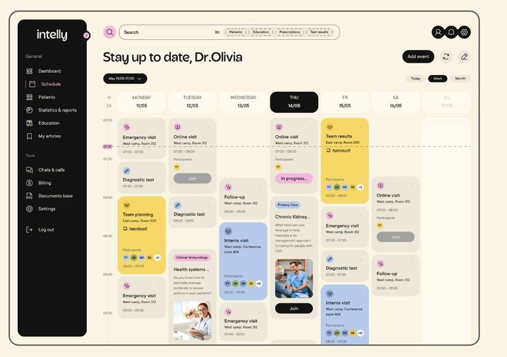

# Referências, procedência e precedência

## Fonte de verdade

A instrução mais recente do mantenedor foi usar a mesma cor descrita no design system. A ordem para execução é: regras atuais de produto/segurança → cores autorais DS 2.1 → composição final deste pacote com as adaptações acessíveis documentadas → imagens de inspiração → orientações das skills. Uma imagem ou skill não substitui um contrato do projeto.

| Fonte | Papel |
|---|---|
| [AGENTS](../../../AGENTS.md), [CONTEXT](../../../CONTEXT.md), [ADRs](../../adr/), [decisões operacionais](../../implementation/decisoes-operacionais.md) | Arquitetura, escopo vigente, isolamento, segurança e execução |
| [Design system](../04-design-system.md), [tokens JSON](../../../design-system/tokens/tokens.json), [CSS gerado](../../../design-system/tokens/tokens.css) | Valores autorais e pipeline de temas |
| [Produto](../05-arquitetura-de-produto.md), [responsividade](../08-responsividade.md), [tickets](../13-tickets.md) | Capacidades e jornadas que precisam continuar existindo |
| [Doc 14](../14-prototipo-interacoes.md), [decisões](../registro-de-decisoes.md) | Histórico DS 2.1 e fronteiras D-027/D-030/D-032; atualização visual registrada em D-033 |
| [Snapshot](prototipo/index.html), [DESIGN](prototipo/DESIGN.md), [PRODUCT](prototipo/PRODUCT.md) | Layout final e comportamentos demonstrativos, com recursos locais |
| [DIAGNOSTICO](prototipo/DIAGNOSTICO.md), [VALIDACAO](prototipo/VALIDACAO.md) | Histórico de correções e limites da validação; trechos pré-correção de paleta não são valores vigentes |
| [Especificação](02-especificacao-visual.md), [integração](03-mapa-integracao.md), [aceite](05-aceite-validacao.md) | Conciliação explícita entre snapshot e produto real |

## Imagens fornecidas pelo mantenedor

As nove imagens vieram do diretório documental **XX - Modelos de layout** fornecido na solicitação. Estão copiadas integralmente com os nomes originais em [referencias/](referencias/), sem depender do disco D: para o executor. São material de inspiração/revisão, não ativos para distribuir na interface do produto. A autoria/licença original dessas imagens não foi informada; não tratá-las como marca, ilustração ou asset licenciado do Segundo Cérebro.

| Arquivo | Papel | Como aplicar |
|---|---|---|
| [405324035233224479.jpg](referencias/405324035233224479.jpg) | Principal do calendário | Hierarquia de período, mini calendário/fontes à esquerda, dias em colunas, eventos legíveis e densidade. Adaptar com lista acessível e fontes reais. |
| [6f53b215d158842dd2f87c07b506ca23.jpg](referencias/6f53b215d158842dd2f87c07b506ca23.jpg) | Composição geral | Distribuição do painel, agrupamentos e relação entre navegação e conteúdo. |
| [546c2fcb4ac63e7a6a5b9db1ae1bacee.jpg](referencias/546c2fcb4ac63e7a6a5b9db1ae1bacee.jpg) | Composição geral | Ritmo de superfícies, hierarquia e respiro entre blocos. |
| [Jack L_.jpg](referencias/Jack%20L_.jpg) | Composição geral | Referência de organização, proporções e acabamento; o nome original foi preservado. |
| [materyal_.jpg](referencias/materyal_.jpg) | Composição geral | Referência complementar de composição e componentes. |
| [a4b91388212ff8aa87ad6f837941a48d.jpg](referencias/a4b91388212ff8aa87ad6f837941a48d.jpg) | Paleta clara histórica | Orientou o estudo inicial; as cores finais vêm exclusivamente do DS 2.1. |
| [58d8e224cf991e707b7c4a74baf6b079.jpg](referencias/58d8e224cf991e707b7c4a74baf6b079.jpg) | Paleta escura histórica | Orientou o estudo inicial; não reintroduzir o rosa/cinza anterior. As cores finais vêm do DS 2.1. |
| [350577152264403735.jpg](referencias/350577152264403735.jpg) | Calendário complementar | Referência da primeira solicitação; secundária diante de 405324035233224479.jpg. |
| [f3532d63f3fba7c8168a3e9c256d7fd1.jpg](referencias/f3532d63f3fba7c8168a3e9c256d7fd1.jpg) | Calendário complementar | Referência da primeira solicitação; secundária diante de 405324035233224479.jpg. |

Referência principal de composição da agenda:

As cores observáveis nas imagens **não** substituem os tokens. Light: canvas `#f5f5f2`, surface `#ffffff`, surface-muted `#efeeea`, ink/accent `#161613`. Dark: canvas `#0d0d0c`, surface `#161615`, surface-muted `#1d1d1b`, ink/accent `#f2f1ec`. Consulte o JSON para todos os papéis; não deduzir uma paleta reduzida a partir desta lista.

## Skills e instruções reproduzíveis

Para a implementação visual, ler as instruções completas antes de usar cada recurso. A Impeccable já é vendorizada no projeto: [SKILL.md](../../../.agents/skills/impeccable/SKILL.md), [critique](../../../.agents/skills/impeccable/reference/critique.md), [audit](../../../.agents/skills/impeccable/reference/audit.md), [animate](../../../.agents/skills/impeccable/reference/animate.md) e [polish](../../../.agents/skills/impeccable/reference/polish.md). Executar o fluxo da versão local e registrar versão, modo e limitações. Não atualizar skills automaticamente como parte do layout.

O repositório de origem [pbakaus/impeccable](https://github.com/pbakaus/impeccable/tree/08d5b470495d242ca0470f4aeae1956c3a074f83) foi fixado para consulta em 17/10/2026. O conteúdo local do projeto é a versão operacional; links externos abaixo são referências complementares fixadas, não autorização para substituir o espelho local.

| Coleção / recurso | Instruções | Revisão consultável |
|---|---|---|
| anthropics/skills / frontend-design | [Instruções fixadas](https://github.com/anthropics/skills/blob/dbd4588f9e1033efb41dad4bef2f7947c8993d44/skills/frontend-design/SKILL.md) | `dbd4588f9e1033efb41dad4bef2f7947c8993d44` |
| bergside/awesome-design-skills / clean | [Instruções fixadas](https://github.com/bergside/awesome-design-skills/blob/f631a09b4fcc0166f2e2c1a8c81906ef680c57e8/skills/clean/SKILL.md) | `f631a09b4fcc0166f2e2c1a8c81906ef680c57e8` |
| bergside/awesome-design-skills / minimal | [Instruções fixadas](https://github.com/bergside/awesome-design-skills/blob/f631a09b4fcc0166f2e2c1a8c81906ef680c57e8/skills/minimal/SKILL.md) | `f631a09b4fcc0166f2e2c1a8c81906ef680c57e8` |
| emilkowalski/skills / emil-design-eng | [Instruções fixadas](https://github.com/emilkowalski/skills/blob/2d228630ba1446365f614a108cb8252f1feda202/skills/emil-design-eng/SKILL.md) | `2d228630ba1446365f614a108cb8252f1feda202` |
| emilkowalski/skills / animate | [Instruções fixadas](https://github.com/emilkowalski/skills/blob/2d228630ba1446365f614a108cb8252f1feda202/skills/animate/SKILL.md) | `2d228630ba1446365f614a108cb8252f1feda202` |

Aplicação: frontend-design orienta direção visual própria, tipografia e composição; clean/minimal orientam agrupamento, redução de ruído e precisão; Emil orienta resposta imediata, interrupção natural e movimento discreto; Impeccable orienta diagnóstico, auditoria e acabamento com evidência. O pedido do mantenedor e o DS prevalecem sobre preferências estilísticas gerais dessas coleções.

## Base, issues e continuidade

- Base inspecionada: [61d03c768071e6618136e648fc71c552e3db2043](https://github.com/kauanbarateli/Segundo-Cerebro/tree/61d03c768071e6618136e648fc71c552e3db2043). Os caminhos do mapa foram conferidos nesta revisão, devendo ser conciliados com mudanças posteriores.
- Execução do layout: [#46](https://github.com/kauanbarateli/Segundo-Cerebro/issues/46).
- Aceite após estabilidade do design: [#44](https://github.com/kauanbarateli/Segundo-Cerebro/issues/44), articulado com [SPEC 01 / #2](https://github.com/kauanbarateli/Segundo-Cerebro/issues/2), [SPEC 06 / #7](https://github.com/kauanbarateli/Segundo-Cerebro/issues/7), [T-005 / #12](https://github.com/kauanbarateli/Segundo-Cerebro/issues/12) e [T-028 / #35](https://github.com/kauanbarateli/Segundo-Cerebro/issues/35).
- [PR #45](https://github.com/kauanbarateli/Segundo-Cerebro/pull/45), HEAD `93ab8549efbdc7c121715ea449c2ce04676585ed` na inspeção, contém handoff paralelo. Não foi mesclado a esta base nem tem seus gates reaproveitados como validação deste pacote.
- Tickets fechados de implementação são contratos históricos, não tarefas para reabrir. O [plano](04-plano-execucao.md) e o [mapa](03-mapa-integracao.md) relacionam essas dependências por módulo.

## Integridade e adaptação editorial

O runtime do snapshot (HTML, JS, CSS, tokens, marca e fonte) foi copiado do protótipo final entregue. Arquivos de texto foram normalizados para LF, retirando linhas vazias excedentes no fim, sem alteração funcional; binários foram preservados byte a byte. O `LEIA-ME.txt` foi adaptado apenas para usar caminho relativo e esclarecer a base. O relatório antigo de `.impeccable/critique/` não foi publicado porque descrevia o estado anterior e continha dependências locais; o diagnóstico consolidado está incluído. O [manifesto](manifest.json) identifica todos os arquivos de referência por SHA-256. As novas [capturas](capturas/README.md) foram geradas usando este snapshot, com dados fictícios.
