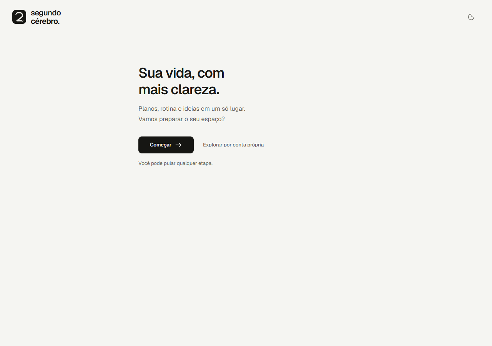
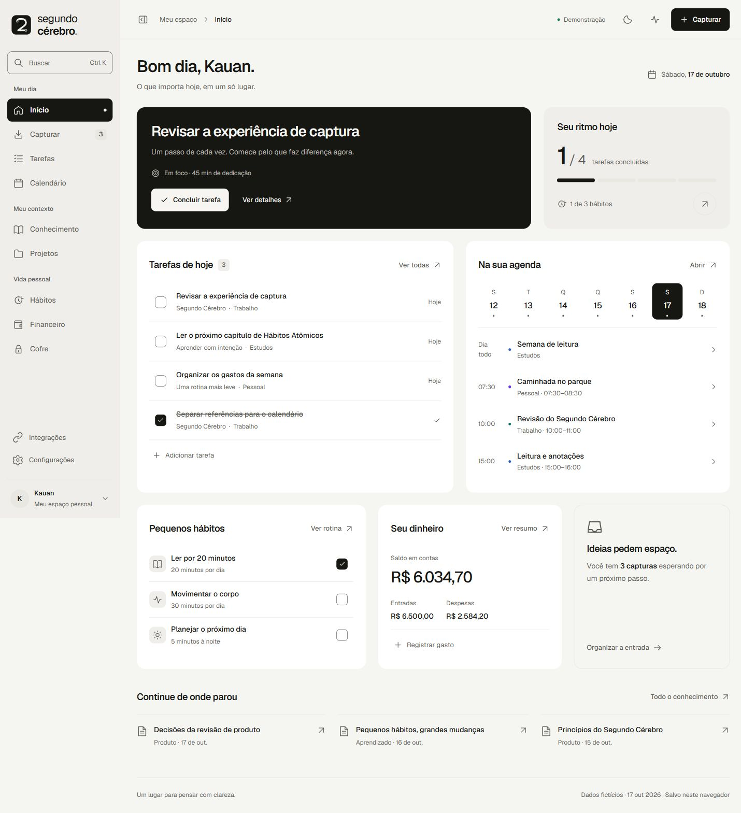
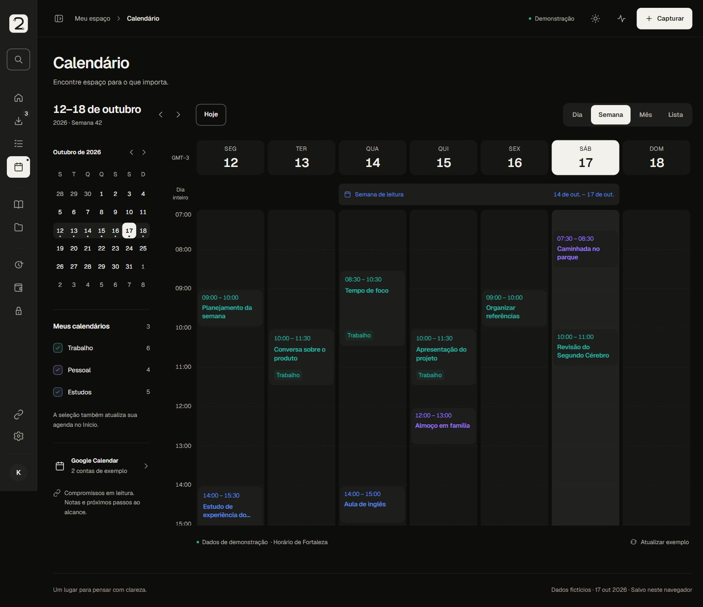

# Aplicação do layout Codex ao Segundo Cérebro

Este pacote permite reproduzir o layout final do protótipo no produto existente: composição, navegação, calendário, temas, microinterações e onboarding simplificado. Contém o código navegável completo, as nove imagens fornecidas, capturas dos dois temas, medidas, mapa de integração e roteiro de aceite. **É um planejamento de implementação; este PR não altera a aplicação de produção.**

Preparado em 17/10/2026 sobre a base [61d03c7](https://github.com/kauanbarateli/Segundo-Cerebro/tree/61d03c768071e6618136e648fc71c552e3db2043). Execução: [#46](https://github.com/kauanbarateli/Segundo-Cerebro/issues/46). Aceite final coordenado com a [issue #44](https://github.com/kauanbarateli/Segundo-Cerebro/issues/44). O [PR #45](https://github.com/kauanbarateli/Segundo-Cerebro/pull/45) é trabalho paralelo, não incorporado a esta base. Antes de implementar, conferir o estado atual de ambos e reconciliar mudanças concorrentes.

## Comece por aqui

1. Leia [AGENTS.md](../../../AGENTS.md), [CONTEXT.md](../../../CONTEXT.md) e este README.
2. Consulte [referências e precedência](01-referencias.md), [especificação visual](02-especificacao-visual.md) e [mapa de integração](03-mapa-integracao.md).
3. Leia [07-onboarding-simplificado.md](07-onboarding-simplificado.md) e suas referências antes de implementar a primeira experiência.
4. Abra [prototipo/index.html](prototipo/index.html) em uma cópia local do repositório. O GitHub mostra o código HTML, não executa a interface.
5. Execute os lotes do [plano](04-plano-execucao.md) e registre evidências conforme a [matriz de aceite](05-aceite-validacao.md).
6. Use o [prompt de execução completo](06-prompt-execucao.md) ou o [complemento de onboarding para a frente em andamento](08-prompt-onboarding.md) para repassar a frente sem depender deste chat ou de diretórios da máquina original.

## Autoridades e conflitos já resolvidos

- **Produto, segurança e dados:** as regras atuais do projeto continuam válidas. As 12 telas do protótipo não representam a totalidade das capacidades de produção. TipTap, anexos, sessões, Admin, Auth, PWA, regras financeiras, criptografia e permissões devem ser preservados.
- **Cores:** usar exatamente o [JSON autoral DS 2.1](../../../design-system/tokens/tokens.json) e seu pipeline de geração. A última instrução do mantenedor substituiu as interpretações cromáticas anteriores. As imagens de paleta são contexto histórico; não extrair novas cores delas. Os modelos de tema em Configurações também usam os valores oficiais de cada tema.
- **Layout:** este snapshot é a referência para composição e navegação das 12 áreas e das nove telas do onboarding simplificado (boas-vindas + sete etapas opcionais + resumo). O [documento 07](07-onboarding-simplificado.md) substitui a composição anterior do tutorial; não recriar o trilho lateral, os painéis ilustrativos ou as explicações simultâneas retiradas. O [doc 14](../14-prototipo-interacoes.md) continua referência histórica e funcional nas partes não substituídas aqui. Novas medidas de componente são aliases locais documentados; não redefinir tokens globais para imitar CSS antigo.
- **Acessibilidade e movimento:** prevalecem campos com fonte de pelo menos 16 px, alvos de 44 × 44 px, foco e teclado, contraste nos fundos reais, motion CSS e preferência por movimento reduzido. A [especificação](02-especificacao-visual.md) resolve explicitamente os deltas do protótipo com esses requisitos.
- **Código de referência:** transportar a aparência para React/Next e componentes existentes. Não transportar roteamento hash, `window.App`, `innerHTML`, dados fixos, localStorage de demonstração ou simplificações de domínio como arquitetura de produção.
- **Corte do MVP:** respeitar D-027 e D-032. Drive, grafo persistente, IA, colaboração, cobrança, novas integrações e notificações push não entram por inferência visual.

## O que há no pacote

| Artefato | Finalidade |
|---|---|
| [prototipo/](prototipo/) | Snapshot navegável final, 12 áreas e onboarding simplificado, recursos locais e relatórios da entrega |
| [referencias/](referencias/) | Nove imagens originais, com papel e origem catalogados |
| [capturas/README.md](capturas/README.md) | Matriz com todas as telas em claro/escuro, sidebar e mobile |
| [02-especificacao-visual.md](02-especificacao-visual.md) | Tokens, hierarquia, medidas, breakpoints, estados e motion |
| [03-mapa-integracao.md](03-mapa-integracao.md) | Fonte visual → rota → componentes → contratos → testes reais |
| [04-plano-execucao.md](04-plano-execucao.md) | Lotes, dependências, divisão de trabalho e entregáveis |
| [05-aceite-validacao.md](05-aceite-validacao.md) | Matriz visual, seis jornadas e gates da aplicação |
| [evidencias/README.md](evidencias/README.md) | O que foi conferido nesta consolidação e limites das provas |
| [07-onboarding-simplificado.md](07-onboarding-simplificado.md) | Nove telas, copy, componentes, estados e adaptação aos contratos reais |
| [manifest.json](manifest.json) | Inventário e SHA-256 dos arquivos de referência |
| [verificar-pacote.mjs](verificar-pacote.mjs) | Conferência local de integridade, links e cores, sem instalar pacotes |

## Como abrir e reproduzir

Depois de obter esta branch/PR, na raiz do repositório:

```sh
python -m http.server 4176 --bind 127.0.0.1 --directory docs/planejamento/15-aplicacao-layout-codex/prototipo
```

Abra `http://127.0.0.1:4176/#/onboarding`. Em armazenamento novo, a apresentação também abre a partir de `#/inicio`; use “Explorar por conta própria” para entrar no painel. Também é possível abrir o `index.html` local: a validação do onboarding incluiu `file://` offline. Não é necessário `npm install` nem backend para esse snapshot. Não execute o servidor de referência em interface pública.

A marca, Geist e sua licença estão incluídas. Mantenha a pasta inteira: a ordem dos seis scripts e das folhas CSS importa. O snapshot usa 17/10/2026 e Fortaleza apenas como cenário demonstrativo; o produto mantém data atual e o fuso oficial de `src/core/tempo`.

Para rever o onboarding, use **Configurações → Rever configuração**; para preparar novos itens, **Configurar mais recursos**. Se pausado, retome pelo banner **Continuar configuração**.

Para repetir os estados: use um perfil local limpo ou **Configurações → Restaurar exemplos** no protótipo. Esta ação apaga somente a demonstração daquela origem. Não usar dados reais, contas externas ou credenciais. Os estados são salvos por origem do navegador; para comparar capturas, mantenha a mesma origem, período e estado de sidebar.

```sh
node docs/planejamento/15-aplicacao-layout-codex/verificar-pacote.mjs
```

O verificador comprova a integridade do material, links locais e correspondência de 82 cores, além de 88 pares de contraste textual. Não substitui testes do produto. [Evidências](evidencias/README.md) distingue resultados do snapshot, inspeção estática e validação de produção ainda pendente.

## Onboarding simplificado

Uma coluna de até 560 px, uma ação principal por etapa e opções secundárias recolhidas. Nome, agenda, hábito, projeto, tarefa, notas e outros espaços são opcionais. “Fazer depois” preserva a retomada; o resumo mostra somente escolhas preparadas. A produção deve adaptar autenticação, OAuth e gravação conforme o documento 07, sem copiar contas fictícias ou armazenamento demo.



Consulte [todas as etapas e estados](capturas/README.md) e as [evidências delimitadas](evidencias/README.md).

## Visão do resultado

Início claro, sidebar expandida:



Calendário escuro, sidebar recolhida:



As capturas são referência visual, não prova de funcionalidades reais. O [índice de capturas](capturas/README.md) reúne as outras telas e os estados mobile.
