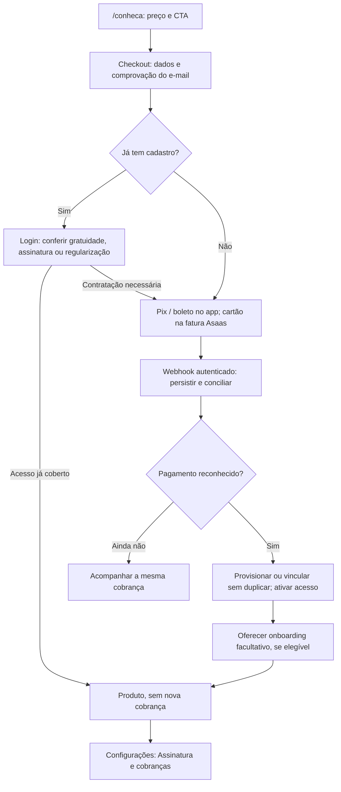

# Checkout Asaas e onboarding — planejamento aprovado

Estado em 18/10/2026: consolidado e divisão em SPEC-07 + 18 tickets aprovados explicitamente pelo mantenedor (D-064), após D-034–D-063. Publicação autorizada, sem iniciar implementação. A direção técnica aceita não comprova homologação nem resolve os gates externos. Consulte o checklist de [preparação exclusiva do mantenedor](06-preparacao-do-mantenedor.md).

## Decisões registradas

| Pergunta / registro | Resposta do mantenedor | Consequência |
|---|---|---|
| Q1 / D-034 | Ampliar o escopo do MVP atual. | Checkout Asaas e onboarding integram o MVP, além dos critérios anteriores. |
| Q2 / D-035 | CPF — pessoa física. | Considerar regras PF; não presumir Pix Automático ou emissão fiscal. |
| Esclarecimento / D-036 | Concorda em mudar para Vercel Pro quando necessário. | Hospedagem comercial é pré-requisito de lançamento; domínio não altera plano. Nenhuma contratação/configuração foi feita. |
| Q3 / D-037 | Checkout próprio; cartão no Asaas. | Dados, método, Pix e boleto no app; captura do cartão na fatura hospedada. O retorno não prova pagamento. |
| Q4 / D-038 | Primeiro e último toque. | Preservar campanha inicial e última campanha antes da contratação; novos UTMs válidos atualizam só o último toque. Demais regras de atribuição seguem abertas. |
| Q5 / D-039 | Adicionar `utm_content` e domínio de origem. | Cinco UTMs; referrer somente com domínio, sem caminho/parâmetros/URL completa. |
| Q6 / D-040 | Até 30 dias entre visitas, com aceite. | Consentimento facultativo para atribuição, separado da contratação. Recusa não impede compra nem pode ser contornada por outro armazenamento. |
| Q7 / D-041 | Medir abandonos por até 30 dias. | Com aceite, guardar UTMs/última etapa para funil, sem marketing; eliminar atribuição individual após prazo. Cobranças têm retenção operacional separada. |
| Q8 / D-042 | Preservar campanha na visita direta. | Visita sem UTMs não apaga último toque válido dentro da janela; nova campanha válida continua atualizando-o. |
| Q9 / D-043 | Preservar contas atuais gratuitas, incluindo Master. | Assinatura para novos cadastros via checkout. Vetos/moderação continuam; isenções futuras e conferência do conjunto atual ainda exigem contrato. |
| Q10 / D-044 | E-mail existente exige login antes de nova cobrança. | Após autenticar, consultar gratuidade/assinatura/regularização, sem cadastro ou contratação duplicados; resposta pública sem enumeração. |
| Q11 / D-045 | Master pode conceder isenção a novas contas. | Concessão explícita e auditada para convidados/testes; não é consequência automática de criar pelo Admin ou alterar o papel. |
| Q12 / D-046 | Vencimento mensal pela data do primeiro pagamento reconhecido. | Contratação dia 10 e reconhecimento dia 12 → próximo vencimento dia 12 do mês seguinte. Ajuste Asaas e fim de mês exigem homologação; atraso posterior não reancora por suposição. |
| Q13 / D-047 | Bloqueio após o fim do quinto dia corrido, São Paulo. | Vence dia 10: acesso até fim do dia 15, bloqueio às 00h do dia 16 sem pagamento reconhecido. |
| Q14 / D-048 | Regularização e gestão da conta durante suspensão. | Login, segurança, cancelamento e solicitações sobre os próprios dados continuam; leitura/escrita dos módulos bloqueadas. Suspensão não apaga dados. |
| Pedido direto / D-049 | Aba Assinatura e cobranças em Configurações. | Central de gestão comercial do próprio Usuário, acessível também na suspensão; detalhar operações e regras financeiras na entrevista. |
| Q15 / D-050 | Cancelar próximas renovações e manter o período pago. | Solicitar pela aba comercial; não encerrar antes o período pago por cancelamento comum. Arrependimento/reembolso, dívidas existentes e tratamento das faturas antecipadas têm contratos próprios. |
| Q16 / D-051 | Pausar novas mensalidades durante suspensão. | Preservar a cobrança que motivou a suspensão para regularização; não acumular novos meses cobrados sem acesso. Retomada definida em D-052; execução sobre faturas futuras exige homologação. |
| Q17 / D-052 | Novo mês e nova data após suspensão. | Quitar a pendência e reconhecer o pagamento concede mês completo e nova âncora; não cobrar meses suspensos. Dentro da tolerância, manter o calendário atual. Ajuste Asaas ainda exige homologação. |
| Q18 / D-053 | Primeiro vencimento em três dias corridos após geração. | Informar antes de pagar; não confundir com validade do QR, compensação do boleto ou âncora mensal. Reconhecimento tardio exige conciliação sem cobrança duplicada. |
| Q19 / D-054 | Confirmar e-mail por link antes de cobrar. | Comprovar endereço sem criar conta Auth antes do pagamento; cadastro existente ainda exige login. Desenhar envio/retomada sem enumeração, abuso ou consumo por scanners. |
| Q20 / D-055 | Avisos somente por e-mail. | Separar avisos financeiros Asaas de confirmação/ativação do projeto; sem SMS/WhatsApp/voz, duplicidade ou marketing implícito. |
| Q21 / D-056 | Preservar módulos por 180 dias após fim efetivo do acesso. | Suspensão sem retorno ou término do período pago após cancelamento; avisar antes de excluir e manter canal para solicitar dados. Separar identidade, retenção financeira/legal e atribuição; não expirar conta gratuita/isenta ativa. |
| Q22 / D-057 | Atribuição individual por 12 meses após contratação paga. | Remover antes se consentimento retirado; depois do prazo só estatísticas sem identificação. Não confundir com 30 dias de visitas/abandonos ou 180 dias dos módulos. |
| Q23 / D-058 | Reembolso parcial autorizado mantém o período contratado. | Não cancela assinatura automaticamente. Integral/chargeback seguem revogação; não confundir com pagamento inicial incompleto ou crédito concedido pelo próprio Usuário. |
| Q24 / D-059 | Preço na abertura e no fechamento da landing. | R$ 29,90/mês junto aos CTAs, recorrência explícita; preservar capítulos visuais. Textos e pontos complementares são propostas de UX. |
| Q25 / D-060 | Foco pessoal salvo no perfil e editável em Configurações. | Facultativo; preservar opções do protótipo sem alterar permissões/módulos. Exige extensão futura do contrato real, não gravação em campo inexistente. |
| Q26 / D-061 | Contexto opcional salvo no Projeto e editável depois. | Pessoal/Trabalho/Estudos; não é foco pessoal nem categoria de Tarefa. Extensão futura versionada sem mudar vínculos ou classificar registros antigos automaticamente. |
| Q27 / D-062 | Revogar isenção de convidado/teste com aviso e sete dias para contratar. | Aviso por e-mail; sem débito/assinatura automática. Depois, gestão da conta; não revogar a gratuidade preservada das contas atuais por esse fluxo. |
| Q28 / D-063 | Congelar atribuição ao confirmar checkout e gerar primeira cobrança. | Antes disso, campanhas válidas podem atualizar último toque; depois, visitas não reescrevem a contratação. Expiração/retirada continuam valendo; não congelar já na simples abertura. |

Ver [registro de decisões](../registro-de-decisoes.md), [ADR-0009](../../adr/0009-cobranca-asaas-e-onboarding-no-mvp.md) e [glossário](../../../CONTEXT.md). Conferência das contas atuais, detalhes de concessão/revogação das isenções e demais escolhas abaixo continuam abertos.

## Requisitos fornecidos

- Entrada pública pela `/conheca`, preservando UTMs até o checkout e associando-os ao Usuário após sua criação.
- Assinatura R$ 29,90/mês por Pix, cartão ou boleto; cadastro automático somente depois do primeiro pagamento reconhecido.
- Cobrança mensal e suspensão comercial após cinco dias corridos completos do vencimento sem pagamento reconhecido (D-047). Vence dia 10 → bloqueia às 00h do dia 16 em São Paulo. Detalhes de regularização/reativação continuam abertos; cobrança futura não é atraso.
- Entitlement comercial distinto de Preferência e ban administrativo; preservar login e regularização.
- Aba **Assinatura e cobranças** em Configurações para consultar e gerir a própria contratação. Durante suspensão, preservar essa aba, segurança, cancelamento e solicitações de dados, bloqueando o uso dos módulos sem apagá-los (D-048/D-049).
- Onboarding facultativo de nove telas: boas-vindas, nome, agenda Google, hábito, projeto, tarefa, notas, outros espaços e resumo. Pausa/retomada, vínculos reais e conclusão idempotente; Drive permanece retirado.
- Núcleo sem SDK, adapter somente de servidor, isolamento, evento atômico por escrita, migrations versionadas e aplicação futura supervisionada segundo OP-009.
- Impeccable/DS 2.1, campos ≥16 px, alvos ≥44 × 44 px, foco, teclado, claro/escuro, contraste medido e movimento reduzido. Nenhum segredo em Git/chat/issues.

## Jornada planejada

Diagrama de comportamento futuro, sem implementação ou prova de integração. Retorno do navegador não substitui confirmação financeira; cadastro novo só após pagamento. Suspensão preserva a gestão da conta e pausa novas mensalidades; os detalhes estão nos contratos e decisões acima.

## Referências e base consultadas

- Esta branch documental parte de `origin/main` em `f3d18960a41076e99aa60dcc9f6b46967970ebb5`, com o layout do PR #48. O checkout anterior `93ab8549efbdc7c121715ea449c2ce04676585ed`/PR #45 permanece preservado em sua branch, sem incorporação aqui.
- [Pesquisa Asaas](https://github.com/kauanbarateli/Segundo-Cerebro/blob/12b572ec0c93aa004bfda7141f40bd5f0ef1b659/docs/implementation/pesquisa-asaas-assinatura-20261018.md): `12b572ec0c93aa004bfda7141f40bd5f0ef1b659`, branch `ccr-41720489-cekj7x`. Insumo de pesquisa, não contrato aprovado.
- [PR #47](https://github.com/kauanbarateli/Segundo-Cerebro/pull/47): HEAD consultado `57a2967f34a11cf985e62827d67179335474f477`, branch `codex/planejamento-layout-ds21`. [Documento 07](https://github.com/kauanbarateli/Segundo-Cerebro/blob/57a2967f34a11cf985e62827d67179335474f477/docs/planejamento/15-aplicacao-layout-codex/07-onboarding-simplificado.md), protótipo JS/CSS, brief, capturas e OB1–OB6 regem o onboarding. Esse complemento ainda não está nesta base Main.
- [#46](https://github.com/kauanbarateli/Segundo-Cerebro/issues/46) foi encerrada após o layout; seus comentários registram onboarding pendente. Coordenar nova entrega sem reabrir/duplicar silenciosamente a issue. [#44](https://github.com/kauanbarateli/Segundo-Cerebro/issues/44) permanece aceite independente. Os 31 testes do protótipo não comprovam o produto conectado.
- AGENTS/CONTEXT, ADRs, D-011/D-019/D-033, roadmap, OP-009 e docs/agents consultados. Skills: grill-with-docs, grilling, domain-modeling e Impeccable; to-tickets aplicada para produzir a divisão submetida à aprovação antes de publicar.

## Conferência documental do Asaas

Fontes públicas conferidas em 18/10/2026, sem executar API autenticada nem sandbox:

- Cliente exige nome e CPF/CNPJ; o produto também precisa do e-mail. Telefone/endereço dependem do método, sem coleta antecipada desnecessária. [Referência](https://docs.asaas.com/reference/criar-novo-cliente).
- `UNDEFINED` consta em assinaturas; comportamento da fatura e do método nos ciclos seguintes ainda exige homologação. [Assinatura](https://docs.asaas.com/reference/criar-nova-assinatura).
- Pix/boleto convencionais geram cobranças, mas exigem pagamento a cada ciclo. Pix Automático é outro fluxo, inelegível para conta PF. [FAQ de assinaturas](https://docs.asaas.com/docs/faq-assinaturas), [FAQ Pix Automático](https://docs.asaas.com/docs/faq-2).
- O produto Checkout Asaas aceita Pix/cartão, sem boleto; não é sinônimo da fatura hospedada escolhida para cartão. [Checkout](https://docs.asaas.com/docs/checkout-asaas).
- A documentação ilustra cartão `CONFIRMED` antes de `RECEIVED`, com intervalo de 32 dias. Pix PF pode aguardar até 72 h sob bloqueio cautelar. A regra fornecida considera cartão confirmado e Pix/boleto recebidos; validar sequências durante execução. [Eventos](https://docs.asaas.com/docs/webhook-para-cobrancas), [cobrança](https://docs.asaas.com/reference/criar-nova-cobranca).
- `PAYMENT_CREATED` existe para assinatura; a exceção mencionada na pesquisa diz respeito à notificação ao cliente, não ao webhook. [Notificações](https://docs.asaas.com/docs/notificacoes-padroes).
- Webhook exige HTTP 200 em dez segundos; quinze falhas consecutivas pausam a fila e eventos antigos podem ser excluídos após quatorze dias. Planejar recebimento durável e processamento recuperável. [Recepção](https://docs.asaas.com/docs/receba-eventos-do-asaas-no-seu-endpoint-de-webhook), [fila](https://docs.asaas.com/docs/fila-pausada).
- Guia/referência divergem no endpoint de troca de cartão; fontes de retentativas também divergem. Não fixar endpoint ou agenda por suposição. [Guia](https://docs.asaas.com/docs/criando-assinatura-com-cartao-de-credito), [referência](https://docs.asaas.com/reference/atualizar-cartao-de-credito-assinatura).
- Chargeback requer apoio do suporte para parte da prova no sandbox; teste sintético não substitui esse aceite. [Recursos testáveis](https://docs.asaas.com/docs/o-que-pode-ser-testado).

Comparativos foram consultados como contexto, sem substituir fontes oficiais Asaas. URLs secundárias que falharam não foram tratadas como confirmação. Taxas contratuais, configuração e habilitações da conta real não foram consultadas.

## Pontos da revisão técnica e provas futuras

As respostas humanas estão na tabela acima. Os itens abaixo separam recomendações de contrato para o aceite do consolidado de provas que só ocorrerão na execução. Não reabrir políticas já decididas nem tratar leitura documental como homologação. A lista de tickets será apresentada antes da publicação.

1. Detalhes de atribuição: marco de início/expiração das janelas de visita/abandono, toques parciais, revogação, limites/normalização e agregados. D-057 decidiu a retenção individual pós-contratação paga em 12 meses.
2. Conferência das contas atuais gratuitas, contrato de concessão/revogação da isenção, comprovação segura sem enumeração e correção de e-mail errado após pagamento.
3. Fim de mês, compensação, estados de reembolso/chargeback e detalhes de retenção. D-048 definiu suspensão; D-050 cancelamento comum; D-051 pausa; D-052 retomada; D-053 primeiro vencimento; D-056 preservação de módulos por 180 dias; D-058 mantém acesso no reembolso parcial autorizado. Ainda falta homologar efeitos, protocolo de exclusão/aviso e retenções separadas.
4. Remetente, agenda e prova de entrega dos avisos por e-mail D-055; custos, reajuste, emissão fiscal e identificação da oferta. Não presumir teste grátis ou outro canal de aviso.
5. Posições/copy complementares dos CTAs, termos/privacidade, domínio e callbacks; D-059 já define preço na abertura e no fechamento. Não presumir liberação de indexação.
6. Elegibilidade, rascunho/retenção/concorrência e confirmação parcial do onboarding; Hoje, vínculo de nota e continuação OAuth. D-060/D-061 já definem os destinos de foco pessoal e contexto de Projeto; faltam suas extensões técnicas versionadas.
7. Eventos pré-Usuário, provisionamento pago sem sessão Master, ativação/senha, precedência em Entitlements/RLS, idempotência, reconciliação e observabilidade.
8. Confirmação da especificação e divisão concluída em D-064. Publicação e vínculos registrados no [doc 07](07-publicacao-github.md).

O ADR-0007 não pode ser exposto como criação pública: exige Master. Eventos/recibos atuais exigem Usuário Auth; o modelo anterior ao primeiro pagamento ainda precisa de desenho próprio. Não criar Usuário fictício nem atribuir a outro Usuário os eventos do checkout.

## Entregas e limites

[Lista para aprovação: SPEC-07 e 18 tickets, T-029–T-046](05-lista-de-tickets-para-aprovacao.md), com entregas, bloqueadores, negativos, validação futura e quatro frentes. Publicação autorizada em D-064 e registrada no [doc 07](07-publicacao-github.md); os IDs T são distintos dos números GitHub.

### Direção técnica aceita com o consolidado (D-064)

| Ponto | Proposta, sem declarar homologação |
|---|---|
| Fronteira comercial | Agregado/eventos/recibos privados antes de Auth; inbox durável antes de HTTP 200; outbox/executor e conciliação; saga paga distinta da autorização Master, conforme ADR-0010. |
| Comprovação por e-mail | Capacidade de uso único, prazo inicial de 30 minutos, confirmação explícita por POST e proteção de links; envio próprio de servidor sem criar Auth nem presumir SMTP genérico do Supabase. |
| Atribuição | Janelas fixas de 30 dias: visitas desde aceite/primeiro toque; abandono desde criação do checkout, sem renovar por atividade. Hostname externo, pacotes sem mistura de campanhas e limites do doc 03. Congelamento na confirmação geradora da primeira cobrança é decisão D-063, não mera proposta. |
| Rascunho do onboarding | Servidor por Usuário/rodada/versão; conflitos explícitos; proposta de 30 dias desde a última edição confirmada, com aviso. Recibos históricos mínimos têm contrato separado; nunca guardar credenciais. |
| Datas e vínculos | Hoje como dia inteiro civil explícito, sem mudar o prazo ao retomar; a primeira nota usa Vínculo Página→Projeto, sem inventar coluna na Página ou mudar o Caderno. |
| Isenção de convidados | Concessão sem expiração automática até revogação explícita; após aviso confirmado, sete dias civis completos de transição em São Paulo, propondo corte às 00h de D+8. Envio falho/incerto não provoca restrição silenciosa. |

**Provas e providências da execução, ainda abertas:** métodos/fatura hospedada e troca de cartão; fonte temporal financeira e ajustes da recorrência; ambiente e remetente de teste; inventário das gratuidades; retenções específicas de identidade/financeiro/legal/backups; textos e atendimento do fornecedor PF; domínio, callbacks, Pro e autorização de lançamento. Esses pontos têm responsáveis/gates nos tickets e não podem ser declarados validados pela aprovação do documento.

Consolidado de [fluxos, estados do checkout e nove telas de onboarding](02-fluxos-e-estados.md): requisitos fornecidos, decisões aprovadas e recomendações técnicas para revisão estão separados, com testes positivos/negativos e limites de execução.

Consolidado de [atribuição de origem e privacidade](03-atribuicao-e-privacidade.md): consentimento, retenção, passagem do checkout ao Usuário, limites e marcos técnicos propostos, plano de validação e obrigações operacionais para o lançamento.

Consolidado de [contratos técnicos](04-contratos-tecnicos-propostos.md): recebimento durável, eventos anteriores ao Usuário, saga paga distinta do Admin, ativação, idempotência e Entitlements/RLS. Direção técnica aceita em D-064; detalhes de execução e homologação continuam futuros.

[ADR-0010 aceito no planejamento](../../adr/0010-fronteira-comercial-e-provisionamento-recuperaveis.md) consolida os trade-offs dessa fronteira técnica. Complementa o ADR-0009 de escopo; sua direção foi aceita em D-064; provas permanecem futuras.

**Registrado:** D-034–D-063, ADR de escopo e glossário. **Preparado:** [guia de chaves e ambientes](01-chaves-e-ambientes.md), fluxos, contratos, privacidade, matrizes de validação, ADR técnico aceito no planejamento e lista aprovada de tickets. **Conferido:** documentação e referências públicas; nenhuma conta Asaas foi consultada. **Aprovado:** consolidado, direção técnica e divisão de tickets (D-064). **Publicado:** SPEC-07 / #50 e 18 tickets #51–#68; ver [registro e vínculos](07-publicacao-github.md). Implementação, aplicação supervisionada, sandbox e lançamento continuam etapas futuras.

Nenhum código, migration, `.env`, serviço, conta Asaas ou plano Vercel foi alterado. Esta etapa publica o planejamento e as issues autorizadas; não repete operações antigas. BlackSheep/VOE/legado permanecem fora da tarefa.
