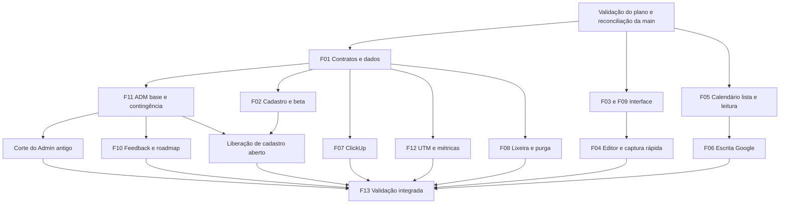

# Plano executivo — evolução pós-MVP

Versão 1.2 · 31/10/2026 · **Planejamento consolidado para validação, sem implementação iniciada.** Base: `main` em `bd35288404c493d1b03f7a1a0208f808cc2079a2`.

## Resultado a entregar

Abrir cadastro por e-mail/Google, com avaliação de 7 dias e continuidade gratuita durante o beta; simplificar as telas atuais; conectar ClickUp; permitir edição de eventos Google avulsos; oferecer lixeira com prazo real; e criar uma administração separada para contas, disponibilidade de módulos, feedback, roadmap e métricas/atribuição consentida.

As 17 respostas estão em [02](02-decisoes-confirmadas.md). Recomendações técnicas deste pacote não são funcionalidades implementadas nem configurações de serviço já aprovadas. O novo ADM passa a integrar o planejamento; seu adiamento no briefing original foi substituído pela respostaQ15. “Alunos” significa Usuários da plataforma neste contexto, sem cursos ou matrículas.

## Limites preservados

- Sem cobrança/checkout, preço na landing, conversão automática para assinatura ou reabertura da entrevista Asaas. Não aplicar regras comerciais antigas ao beta.
- Sem Apple nesta primeira entrega, edição de recorrências Google, Chat/DM ClickUp, PDF/áudio em Capturas, anexos/e-mails de feedback ou novo Drive.
- Sem leitura administrativa do conteúdo de notas, financeiro, Cofre, agendas ou tarefas pessoais. Administração recebe metadados operacionais e a jornada de aquisição consentida delimitada no doc 10.
- Sem redesenho de paleta, família tipográfica ou lógica financeira/hábitos. Preservar DS 2.1, reservas virtuais e cadência com vigência.
- Remover card de PWA não remove a capacidade de instalação nem o trabalho separado do PR #127.

## Priorização e mapa de frentes

P0: acesso, integridade e condições para liberar cadastro. P1: fluxo principal e capacidades solicitadas. P2: acabamento independente. Esforço relativo: S(pequeno), M(médio), L(grande), XL(múltiplas entregas). São comparações, não dias ou promessa de cronograma; aprovação de provedores depende de terceiros.

| Frente | Entrega | Prioridade / esforço | Dependências principais |
| --- | --- | --- | --- |
| F01 | Contratos de acesso, feature availability e evolução de dados | P0/L | Plano validado; reconciliar histórico 5/27 e patch PT409 |
| F02 | Landing, cadastro, Google login, beta e entrada no onboarding | P0/L | F01; Google/SMTP; suporte administrativo disponível |
| F03 | Marca, header, tema imediato, overlays e microcopy | P1/M | DS atual; contratos de foco/tema |
| F04 | Captura rápida e simplificação Capturar/Conhecimento | P1/L | F03; reaproveitamento dos contratos do editor |
| F05 | Calendário em lista única e detalhes completos de leitura | P1/M | Projeção Google e compatibilidade do cache |
| F06 | Permissões e escrita de eventos avulsos Google | P1/L | F05; OAuth e ACL; verificação Google |
| F07 | ClickUp: conexão, leitura, escrita e sincronização | P1/XL | F01; app OAuth; executor e limites |
| F08 | Lixeira 7 dias e exclusão definitiva | P0/L | Plano referencial/retensão; contingência; scheduler |
| F09 | Configurações e cartões de Projetos | P2/M | F03; preservar APIs existentes |
| F10 | Feedback privado, retorno e roadmap autenticado | P1/L | F01; F11 para operação e publicação |
| F11 | ADM separado e retirada dos canais administrativos antigos | P0/XL | F01; domínio/DNS; autenticação forte; contingência |
| F12 | UTM, jornada consentida e métricas de uso/cadastro | P1/L | Catálogo UTM; F02; F11; consentimento/políticas |
| F13 | Validação integrada, corte e entrega | P0/L | Frentes liberadas e provas próprias por ambiente |

## Sequência executável

1. **E0 — Preparação:** validar este plano, comparar a nova main com o SHA analisado, usar a auditoria do doc 16, reconciliar histórico 5/27 e o patch PT409, e conferir ambientes ainda não auditados. Preparar branches/PRs pequenos. Não mudar migrations históricas.
2. **E1 — Fundação e ADM mínimo:** F01 e base deF11; desenvolver autenticação administrativa, usuários, liberação de módulos, auditoria e contingência. Só desligar canais antigos após esse substituto e a recuperação estarem comprovados. Proteger o caminho de cadastro público por flag desligada.
3. **E2 — Entrada e relacionamento:** F02, F10 e F12 podem ser construídas em paralelo após contratos comuns. Conectar tela de feedback ao ADM; preparar cadastro/consentimento e registro de origem antes de pretender medir o lançamento. Falta de atribuição nunca impede cadastro.
4. **E3 — Uso diário:** F03/F09 e F04; F05 sem esperar a escrita Google. Comparar claro/escuro/mobile e preservar rascunhos/links existentes.
5. **E4 — Integrações:** F06 e F07 em entregas separadas de leitura, escrita e sincronização; contas de teste e efeitos remotos verificáveis. Não prometer capacidade antes do consentimento e da prova conectada.
6. **E5 — Retenção:** F08 primeiro em fixtures/QA, depois inventário agregado dos elegíveis e ativação controlada com carência do legado. A liberação visual do aviso deve corresponder ao serviço real.
7. **E6 — Corte final:** F13, documentação e evidências por SHA/ambiente; autorizações de deploy/schema conforme regras vigentes. Não unir todos os pacotes num único merge impossível de revisar.

Interface independente e estudo de integrações podem avançar em paralelo; as mesmas primitivas, migrations e contratos não devem ser editados por duas frentes ao mesmo tempo. Um responsável integra cada fronteira compartilhada.

## F01 — Fundação de acesso e contratos

**Objetivo/diagnóstico:** o Plano Pessoal atual concede capabilities salvo veto; a lista de chaves é estática. Isso não permite lançar abas novas fechadas por padrão apenas escondendo links.

**Pré-etapa de dados:** o catálogo real contém as 67 tabelas esperadas, mas apenas cinco das 27 migrations estão registradas. Reconciliar proveniência e ledger em procedimento revisado, sem reaplicar automaticamente as 22 restantes. Incorporar o wrapper operacional PT409 às expectativas de release; o resultado bruto atual continua com uma divergência em 2.512 verificações. Ver critérios DB-REC-01/02 no [doc 16](16-auditoria-supabase.md).

**Solução:** distinguir disponibilidade de lançamento, entitlement individual e preferência; novo recurso nasce restrito e tem acesso validado no servidor. Preservar a disponibilidade das funcionalidades existentes e o veto de moderação. Adicionar estado explícito de beta/avaliação sem inferir gratuidade pela ausência de cobrança.

**Arquivos/dados/APIs:** `src/core/access/resolve-access.ts`, `src/core/contracts/modules.ts`, guards/runtime Auth e RPCs de acesso; tabelas/políticas propostas no doc 07/09; novas migrations versionadas, tipos e testes de catálogo. Flags propostas devem ter defaults conservadores, sem habilitar vendas. Nenhum segredo no cliente.

**Dependências/riscos:** resolver a precedência de regras antes de F02/F10/F11; risco de liberar recursos por URL ou bloquear módulos antigos. **Aceite/testes:** matriz de usuário comum/Master/bloqueado, feature nova/restrita/lançada, veto e preferência; chamada direta nega o mesmo acesso que a UI. Mudança de permissão afeta operações em curso sem confiar em JWT antigo.

## F02 — Entrada pública e beta

**Objetivo/diagnóstico:** há login/recovery e onboarding de 9 telas, mas não cadastro público, login Google ou trial implementados. `/auth/callback` pertence à recuperação.

**Solução:** `/conheca` simplificada → `/criar-conta` proposto → confirmação de identidade → onboarding retomável → app. Login Google pede identidade, não calendário. Usuários existentes entram no destino anterior e não refazem onboarding obrigatoriamente. Recomenda-se início único do período na primeira sessão verificada; ao fim, acesso continua no beta gratuito. Landing informa isso sem preço ou cobrança fictícia.

**Arquivos/dados/APIs/env:** `src/components/features/conheca/`, `src/components/features/auth/`, `src/lib/auth/{runtime,service,ports,actions}.ts`, `src/core/onboarding/`, `src/app/auth/callback/route.ts` preservado; nova rota social/cadastro no doc 06. Estado de acesso/ciência legal versionada e bootstrap atômico no doc 07. Configurar provider e SMTP no Supabase, redirects e segredos conforme doc 06; não adicionar senha SMTP ao app sem necessidade.

**Dependências/riscos:** F01 e canais administrativos de suporte; e-mail, DNS, Google e moderação. Riscos: duplicar conta, tomar identidade por e-mail não verificado, loop de onboarding, liberar cadastro pelo client. **Aceite/testes:** e-mail e Google completos; links expirados/duplicados; conta existente e bloqueada; senha/social sem senha;7 dias e isenções; retry sem duplicidade. Consentimento de atribuição é opcional e separado das políticas. O checkbox do login solicitado continua funcional; nova ciência no cadastro não deve ser vendida como parecer jurídico.

## F03 — Elementos globais

**Objetivo/diagnóstico:** favicon já existe, tema no header abre select e drawer comum fica colado à direita. A landing ainda contém Princípios e controles no rodapé.

**Solução:** conferir favicon/metadata/cache; marca stacked do login; retirar seção e âncoras Princípios; tema/Entrar no header público; tema autenticado com alternância imediata, Sistema preservado em Configurações. Painéis com respiro e comportamento apropriado a formulário/teclado mobile. Retirar mensagens técnicas rotineiras, preservando erros, conflitos e resultado incerto.

**Arquivos/dados/APIs:** `src/components/layout/workspace-shell.tsx`, componentes de tema, `src/components/ui/dialog.tsx`, `dialog.css`, `brand.tsx`, `src/app/icon.svg`, features/conheca e aliases. Sem mudança de schema prevista; persistência do tema usa o contrato existente.

**Riscos/testes/aceite:** componente compartilhado pode quebrar Cofre/Financeiro e empilhamento de foco. Testar teclado, Escape, retorno de foco, temaSistema→explícito, abas concorrentes e falha de save; 320–1440px, contraste e movimento reduzido. Nenhuma restrição de autorização pode ser removida como “ruído”. Detalhamento: doc 08.

## F04 — Captura e conhecimento

**Objetivo/diagnóstico:** Capturar do header navega; editores contêm rascunhos, CAS e metadados visíveis. Modelos de Captura/Página diferem.

**Solução:** ação do header abre composer reutilizado sem mudar rota; salvar confirma, fecha e oferece abrir a captura. Formatação agrupada em menu que preserva seleção; configurações da nota reúne tipos/associações existentes. Título/corpo protagonizam. Sem PDF, novo tipo de Página ou autosave que altere o contrato atual.

**Arquivos/dados/APIs:** `features/capturar/capture-view.tsx`, `components/editor/document-editor.tsx`, conhecimento, `src/core/capturas/`, `/api/capture-tasks`, pipeline de imagens e focus-stack. Sem schema novo por escopo; extração respeita proibição de imports cruzados entre features. Limites reais:6 imagens,8 MiB/24MP; texto simplificado não retira validação.

**Dependências/riscos:** F03; risco de perder seleção/rascunho, duplicar escrita ou esconder conflito. **Aceite:** criar a partir de outra tela sem sair; falha mantém trabalho; envio incerto consulta/reutiliza intenção, não duplica; foco e fechamento controlados; atalhos, promoção, Reader/Edit e vínculos preservados. Testes existentes de captura/conhecimento recebem somente cenários impactados.

## F05/F06 — Calendário

**Objetivo/diagnóstico:** lista lateralizada já existe; também há3outras vistas e preferência inicial. Participantes existem sem fotos; descrição/Meet/etag/ACL e escrita ainda faltam.

**Solução F05:** vista lista única, com filtros/fontes/período/Hoje e URLs normalizadas; ampliar DTO e cache para os detalhes reais. **F06:** modo leitura como padrão; upgrade explícito para edição respeita scopes e ACL; criação/edição/cancelamento de avulsos, inclusive dia inteiro, fuso, participantes, descrição e Meet disponível. Recorrências continuam em leitura/linkGoogle.

**Arquivos/dados/APIs/env:** `src/core/calendario/`, `src/adapters/db/google-calendar-*`, `features/calendario/`, Configurações, `/api/calendar/`; alterações de fontes/eventos/credenciais e journal de operações no doc 06. Variáveis existentes preservadas; flag de escrita proposta. Cache antigo exige resync versionado.

**Dependências/riscos:** Calendar API/consentimento, F05 antes deF06; convites geram efeitos externos. **Aceite:** readonly não escreve por endpoint; recusa de scope/ACL; aviso de convidados; etag412 preserva rascunho; timeout não duplica evento; Meet pendente/falho; fuso/DST/dia inteiro; conta revogada e cache parcial. Callback social não substitui Calendar.

## F07 — ClickUp

**Objetivo/diagnóstico:** ainda não há integração. **Solução:** OAuth, uma identidade inicial e Workspaces selecionados; seção própria em Tarefas, espelho separado. Buscar somente atribuídas ao usuário e não concluídas, incluir suas subtarefas e pai autorizado apenas contextual. Editar status/descrição, enviar comentários; nada de Chat/DM.

**Arquivos/dados/APIs/env:** novos Core/adapters/rotas propostos no doc 06; credenciais cifradas privadas, espelhos com dono, cursores/jobs e intenções de escrita. Não usar lixeira de tarefa nativa para deletar remoto. Client ID/secret/chaves de cifragem exclusivos; cron seguro.

**Dependências/riscos:** OAuth ClickUp, F01, scheduler; sem CAS remoto garantido, comentários podem duplicar se reexecutados às cegas. **Aceite:** >100 tarefas, status customizados done/closed, remoção de responsável, pai não acessível,429/403/revogação, conflito e resultado incerto. Sincronizar ao abrir/manual/fundo~5 min com indicação de frescor; cursor só avança depois do lote completo. Desconectar impede novos trabalhos e elimina credencial/cache conforme contrato; não alegar revogação remota se API não a oferece.

## F08 — Lixeira e exclusão

**Objetivo/diagnóstico:** soft delete/restore existe; purga7 dias não. Conhecimento usa lote de exclusão de subárvore; eventos/recibos e imagens também podem conservar conteúdo.

**Solução:** exclusão definitiva manual confirmada e purga por prazo para tarefa/captura/página; arquivado preservado. Para legado, vencimento=max(data original+7 dias, ativação+7 dias), sem reescrever a data original. Job idempotente limitado e observado; restauração e purga concorrem sob trava/condição atômica. Limpar conteúdo mantendo marcadores mínimos contra replay; arquivos compartilhados continuam enquanto houver referência válida.

**Arquivos/dados/APIs/env:** `src/core/tarefas/`, `capturas/`, `conhecimento/`, adapters correspondentes, Storage/recibos, novas RPCs e scheduler propostos no doc 07. Guard de ativação desligado por padrão; não reutilizar retenção de onboarding como se atendesse ao domínio.

**Dependências/riscos:** inventário referencial e prova em QA, contingência e comunicação. **Aceite:** fronteiras antes/no/depois do prazo; carência; restore×purge; subárvore parcial; vínculos/cópias; anexo compartilhado; job interrompido/repetido; outro usuário negado; replay antigo não recria dado. Exclusão definitiva é irreversível; desligar job não restaura dados já purgados.

## F09 — Configurações e Projetos

**Objetivo/diagnóstico:** configurações em coluna, cards redundantes; projetos já possuem capa e progresso real. **Solução:** duas colunas quando couber, uma no celular; remover apenas cards de instalação e Meus dados/âncoras. Sessões, segurança e legais permanecem. Refinar capa, texto, progresso e ações de Projetos; não adicionar prazo/status fictício do mock.

**Arquivos/dados/APIs:** `settings-connected-workspace.tsx`, `settings.css`, `projects-workspace.tsx`, `projects.css`; APIs/dados existentes. **Aceite/riscos:** saves independentes não apagam rascunhos de outro grupo; títulos longos/sem capa/vazio; reflow/foco; exclusão de Projeto preserva itens vinculados. F03 é a dependência compartilhada. Sem migration prevista.

## F10 — Feedback e roadmap

**Objetivo/diagnóstico:** Ajuda é estática, sem persistência de solicitações. **Solução:** `/feedback` com categoria/texto e histórico próprio; `/atualizacoes` com cinco colunas pedidas, apenas leitura aos usuários. Raio no header com nome acessível. ADM faz triagem/resposta/vínculo a melhoria; nenhuma sugestão vira pública automaticamente. Retorno no app, sem anexos/e-mail.

**Arquivos/dados/APIs:** domínios/rotas/tabelas propostos no doc 07/09; alias da Ajuda; sidebar/perfil/header. Pedidos privados, updates visíveis ao autor, itens publicados e relações; RLS e audit. **Dependências/riscos:** F01 e F11; vazamento de reclamações, falsa promessa de retorno, status editado pelo cliente. **Aceite:** autor lê somente próprios; operador responde; publicação sanitizada; nenhuma movimentação pública de coluna;12 meses após fechamento com purge testado e efeito de exclusão da conta. Mudanças de status internas não são comentários sociais.

## F11 — Administração separada

**Objetivo/diagnóstico:** Admin real existe dentro do produto, com saga e proteção do último Master. **Solução:** aplicação/deployment separado em `adm.segundocerebroapp.com.br`, mesmo monolito modular compartilhado por contratos; identidade visual consistente. Usuários, ficha, liberação de funcionalidades, sugestões, roadmap, métricas e auditoria. Autenticação forte e autorização servidor/banco; cookie de um host não dá acesso ao outro.

**Arquivos/dados/APIs/env:** Core/admin/runtime atuais reaproveitados; build/entrada administrativa separada proposta no doc 09; catálogo/disponibilidade e modelos F10/F12; configuração própria de origin/segredos/deploy. Conferir DNS/certificado/redirects sem criar nada nesta fase.

**Dependências/riscos:** F01; contingência comprovada antes do corte; hostname sozinho não protege APIs/RLS. **Aceite:** usuário comum/bloqueado e chamada direta negados; Master+MFA aceitos; não bloquear último Master; ações auditadas; módulos novos negados por padrão; host antigo nega página/APIs, inclusive aliases e saúde administrativa; não há senha/token/conteúdo pessoal na ficha. Plano completo: doc 09.

## F12 — Atribuição e métricas

**Objetivo/diagnóstico:** nenhum coletor/migration de atribuição na main; nenhuma estrutura dedicada localizada no catálogo remoto pesquisado. **Solução:** após reconciliar a base de migrations, implementar coleta consentida e minimizada, vínculo seguro ao cadastro e cronologia na ficha ADM. Não reconstruir visitas não observadas. Separar aquisição de métricas operacionais de uso.

**Arquivos/dados/APIs:** frontend público, Auth/cadastro, novos contratos/routines e modelos propostos no doc 10. Cinco UTMs e domínio de origem, eventos internos permitidos, consentimento/retirada/retensão e métricas agregadas. Recusa não bloqueia cadastro; coortes e atividade excluem QA/operadores conforme definição do relatório.

**Dependências/riscos:** F02/F11, inventário de schema, novas finalidades e política; identificação excessiva, união errada de visitante com usuário, logs reproduzindo campanhas. **Aceite:** nenhuma aquisição/UTM antes do aceite; atividade operacional tem finalidade e transparência próprias, separadas do consentimento de campanhas; timeline ordenada/deduplicada, com lacunas explícitas; negação/retirada/apagamento; múltiplas abas/contas; cadastros e DAU/WAU/MAU com definições reproduzíveis. Ver doc 10 para limites e retenção recomendada do novo fluxo gratuito.

## F13 — Validação e corte

**Objetivo:** demonstrar os fluxos completos, não apenas telas. **Entregáveis:** doc 11, matriz de requisitos, evidências por SHA/ambiente, lista de configuração real e rollback por frente. Sem dado pessoal em capturas de teste.

**Aceite:** checks pertinentes ao diff; testes de domínio/canais/RLS, efeitos remotos em contas QA, navegação/contraste/teclado/mobile e prova de scheduler. Não reaproveitar números de CI do PR #120 como se fossem testes desta mudança. Migrations aplicadas somente de modo supervisionado nos destinos autorizados, nunca por build/deploy. Falha de prova externa fica pendente, sem converter teste sintético em PASS conectado.

## Critério de conclusão do planejamento

Escopo e decisões rastreáveis; cada frente tem objetivo, diagnóstico, solução, caminhos/contratos, dados/configuração, dependências, riscos, testes, aceite e esforço. O pacote termina em validação pelo mantenedor. Execução futura deve seguir [13-prompt-de-execucao.md](13-prompt-de-execucao.md) e reconciliar a main; não há publicação de issues/PR ou autorização de operação criada implicitamente por estes documentos.

## Ajustes transversais após a auditoria Supabase

- F02: tratar o aviso de proteção contra senhas vazadas, conferindo o plano Supabase e os fluxos Auth; não inferir esse plano pela assinatura Vercel.
- F06: otimizar as quatro policies own_read do Calendar preservando guards e resultados de autorização.
- F08: o cron de onboarding existente não cobre a lixeira de sete dias; criar e testar sua manutenção própria.
- F01/F13: preservar os 36 fechamentos intencionais sem policies, validar comportamento em QA e reconciliar ledger/patch antes de schema novo.
- Triar os 25 avisos de FK e 27 índices sem uso por consultas e volume; não criar/remover índices indiscriminadamente.

Detalhes e aceites estão no [doc 16](16-auditoria-supabase.md). Essas tarefas integram as 13 frentes existentes; não alteram as decisões de produto.

